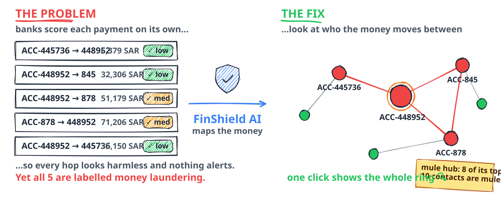

<div align="center">


<br/>


<br/><br/>

**Trace a whole money-laundering ring from one suspicious transaction.**<br/>
FinShield AI scores 5.08 million bank transactions with machine learning, explains each decision with SHAP,<br/>
and maps the linked accounts, **mule chains** and **suspicious hubs** behind every alert.

<br/>

[Problem](#-the-problem) ·
[Solution](#-how-finshield-ai-solves-it) ·
[**The unique part**](#%EF%B8%8F-the-unique-part--follow-the-money) ·
[Features](#-what-you-get) ·
[Screenshots](#-screenshots) ·
[Results](#-results) ·
[Architecture](#-system-architecture) ·
[Pipeline](#-project-pipeline) ·
[User flow](#-user-flow) ·
[Run it](#-getting-started) ·
[Future: Agentic AI](#-future-scope--finshield-agents)

</div>

---

## 🚨 The problem

Criminals launder an estimated **2–5 % of global GDP every year** ([UNODC](https://www.unodc.org/unodc/en/money-laundering/overview.html)). Banks are expected to catch it, but the tools they use make that hard:

<table>
<tr>
<td width="25%" valign="top" align="center"><h3>🔍</h3><b>A needle in a haystack</b><br/><sub>Only 5,177 of 5,078,336 transactions are laundering, 1 in 979. Flag too much and analysts drown; flag too little and the crime gets through.</sub></td>
<td width="25%" valign="top" align="center"><h3>🕸️</h3><b>Laundering hides in networks</b><br/><sub>Money is split and passed through chains of <i>mule</i> accounts. Each single payment looks normal, so models that score one row at a time miss the pattern.</sub></td>
<td width="25%" valign="top" align="center"><h3>⬛</h3><b>Black-box scores</b><br/><sub>"Risk 0.87" isn't something an analyst can act on, or a regulator can accept. Every alert needs a reason.</sub></td>
<td width="25%" valign="top" align="center"><h3>⏳</h3><b>Slow investigations</b><br/><sub>Tracing linked accounts, checking history and writing the Suspicious Activity Report means jumping between tools for every case.</sub></td>
</tr>
</table>

<picture>
  <source media="(prefers-color-scheme: dark)" srcset="docs/assets/problem_solution_dark.svg">
  
</picture>

<div align="center"><sub>The same four payments around <code>ACC-448952</code>: scored one at a time they raise <b>0 alerts</b>; drawn as a network they close a laundering ring.</sub></div>

---

## 💡 How FinShield AI solves it

| The problem | What FinShield AI does |
|---|---|
| 🔍 **Needle in a haystack** | 7 ML models plus LSTM and CNN-1D are trained on 30 behavioural features. The champion **XGBoost reaches AUC-ROC 0.973**, and a calibrated **Risk Engine** turns 5.08M scores into LOW / MEDIUM / HIGH / CRITICAL tiers. |
| 🕸️ **Laundering hides in networks** | A **graph of all 515K accounts** (PageRank, cycles, communities, mule scores). **One click on any account or transaction maps every linked account**, so you can follow the money hop by hop. |
| ⬛ **Black-box scores** | **SHAP** explains every decision in plain English ("ACH payment, 4 transfers this hour…"), both in the User Portal and in the Workbench's *Why flagged?* tab. |
| ⏳ **Slow investigations** | The **Investigation Workbench** puts the alert queue, case file, SHAP, the linked-account map, account history, an **auto-drafted SAR** and an **audit log** in one screen. |

---

## 🕸️ The unique part — *follow the money*

Most fraud models score each transaction **on its own**, so a payment either passes or it doesn't.
Money laundering doesn't work like that. Money moves through **chains of mule accounts** and gets layered
until it looks clean, and every single hop can look harmless by itself.

FinShield AI is built around the network. **Click one account or transaction and every linked account
appears.** Click any of them and the map re-centres there, so you can walk the ring hop by hop.

<div align="center">

### Overview → Linked Account Network


<sub>Recorded from the running dashboard on the real dataset. Three clicks walk a laundering ring in community 24: ACC-445736 → 448952 → 845 → 878.</sub>

</div>

<div align="center">

| 🔴 **Red node** | 🟠 **Orange ring** | 🟢 **Green edge** / 🔵 **blue edge** | 🏷️ **Edge label** | 👆 **Click a node** |
|:---:|:---:|:---:|:---:|:---:|
| account in a *suspicious community* | account flagged as a **mule** | money **in** / money **out** | amount moved on that link | re-centre the map there |

</div>

#### Why it matters: a real finding from the dataset

<table>
<tr>
<td width="25%" align="center"><h2>27</h2><sub>labelled laundering transactions at <b>ACC-448952</b></sub></td>
<td width="25%" align="center"><h2>0</h2><sub>of them reached the alert threshold. Each scored LOW or MEDIUM on its own</sub></td>
<td width="25%" align="center"><h2>8 / 10</h2><sub>of its busiest counterparties are flagged <b>mule accounts</b></sub></td>
<td width="25%" align="center"><h2>3 clicks</h2><sub>to see the ring close: 445736 → 448952 → 845 → 878 → back to 448952</sub></td>
</tr>
</table>

> **The single-transaction score misses this ring. The network view shows it immediately.** That's why FinShield AI is built around the graph.


<div align="center">

### Investigation Workbench → one transaction, the whole case


<sub>Look up <code>TX-2132660</code> → <b>Why flagged?</b> (SHAP) → <b>Linked accounts</b> (Cytoscape.js) → two hops → double-click to re-centre. Red links are transactions labelled as laundering.</sub>

</div>

---

## ✨ What you get

<table>
<tr>
<td width="33%" valign="top">

### 🕵️ Investigation Workbench
- Alert queue of **129,124** Risk Engine alerts, with live counts by analyst decision
- Look up any **transaction, alert or account** across all 5.08M rows instantly, using a numpy byte-offset index
- **Linked accounts** map: 1–2 hops, laundering links in red, click for details, double-click to re-centre
- Full **account history** with risk per transaction
- Analyst actions (confirm, escalate, dismiss) saved to an **audit log**
- **Auto-drafted SAR** (Suspicious Activity Report)

</td>
<td width="33%" valign="top">

### 🧑‍💼 User Portal
- **Transaction Composer**: describe a payment in plain terms (amount, method, banks, time). The server builds all **30 model features** from those inputs
- **Risk Verdict**: `APPROVE · REVIEW · HOLD · BLOCK`, a calibrated risk **percentile** against 5.08M real scores, and plain-English **SHAP reasons**
- Six one-click scenarios: salary, card, structuring, layering, crypto cash-out, large wire
- **Link Security**: a phishing-URL checker with red-flag reasons

</td>
<td width="33%" valign="top">

### 📊 Overview + 11 notebook tabs
- Executive summary of the whole pipeline
- **Transaction Overview** search, plus the **Linked Account Network** with mule-account suggestions
- One tab per notebook: cleaning, EDA, feature engineering, preprocessing, 7 ML models, CNN, LSTM, graph, SHAP, risk engine
- **Live Prediction** console with SHAP factors
- Every number is read live from the notebooks' saved outputs, nothing hard-coded

</td>
</tr>
</table>

---

## 📸 Screenshots

<div align="center">

#### User Portal — the same model, three different decisions


</div>

<table>
<tr>
<td width="50%"><b>Investigation Workbench — two-hop money map</b><br/></td>
<td width="50%"><b>Why flagged? — per-transaction SHAP</b><br/></td>
</tr>
<tr>
<td width="50%"><b>Auto-drafted Suspicious Activity Report</b><br/></td>
<td width="50%"><b>Overview — transaction search + mule suggestions</b><br/></td>
</tr>
<tr>
<td width="50%"><b>ML Model Comparison — 7 models, one held-out test set</b><br/></td>
<td width="50%"><b>Exploratory Data Analysis</b><br/></td>
</tr>
<tr>
<td colspan="2"><b>Graph Network Analysis — 515K accounts, 812 circular flows, 3,351 communities</b><br/></td>
</tr>
</table>

---

## 📈 Results

**Dataset:** IBM AML synthetic transactions (*HI-Small*). 5,078,336 transactions, 515,080 accounts and 5,177 laundering cases, a **979 : 1** class imbalance.

<table>
<tr><td valign="top" width="58%">

#### 7 classical models — same 1,015,668-row held-out test set
| Model | AUC-ROC | AUC-PR | Recall | Fraud caught |
|---|:---:|:---:|:---:|:---:|
| 🥇 **XGBoost** (300 trees) | **0.9709** | **0.2379** | 51.1 % | 529 |
| LightGBM (300 trees) | 0.9707 | 0.2362 | 50.8 % | 526 |
| Hist Gradient Boosting | 0.9707 | 0.2177 | 68.2 % | 706 |
| Random Forest (200 trees) | 0.9687 | 0.0878 | 85.1 % | 881 |
| AdaBoost | 0.9579 | 0.1523 | 84.9 % | 879 |
| Decision Tree (depth 5) | 0.9554 | 0.0255 | 85.7 % | 887 |
| Logistic Regression | 0.9505 | 0.0149 | 93.7 % | 970 |

<sub>The **production XGBoost** (30 features, used by SHAP, the portal and the risk engine) reaches **AUC-ROC 0.9732**.</sub>

</td><td valign="top">

#### What the graph adds
| Graph signal | Fraud rate |
|---|:---:|
| Dataset baseline | 0.102 % |
| Transactions touching a **cycle** (812 found) | **0.485 %** · 4.8× |
| Inside **suspicious communities** | **1.41 %** · 14× |
| **Mule score 4** accounts | **3.64 %** · 36× |

#### Honest notes
- The CNN-1D sequence model is close to random on this data (AUC-ROC 0.587). The dashboard reports that openly instead of hiding it.
- The Risk Engine has a live diagnostic: at the same 2.54 % alert budget, ranking by **XGBoost alone catches 4.35× more fraud** than the current ensemble. Re-weighting it is on the roadmap.

</td></tr>
</table>

---

## 🏗️ System architecture

<picture>
  <source media="(prefers-color-scheme: dark)" srcset="docs/assets/architecture_dark.svg">
  
</picture>

<div align="center"><sub>Source → Pipeline → Artifacts → Serving → Interface. Moving dots show data flowing; the red dashed loop sends every analyst decision to the audit log.</sub></div>

<details>
<summary><b>How the serving layer is put together</b></summary>

- **`dashboard/app.py`** is the core backend. It holds a registry of every model and result file and serves the overview, the 11 notebook tabs, live prediction and the chart server.
- **`dashboard/new.py`** *imports* `app.py` instead of copying it, adds the User Portal and Investigation Workbench APIs, and injects `new.html` + `new.js` into the page.
- **`new1/new1.py`** is the entry point for the new design. It imports `new.py` and adds the header with four main tabs (Overview · User Portal · Investigation Workbench · Live Prediction), notebook sub-tabs 01–10, a ⌘K / Ctrl+K command palette and deep links.
- A **transaction index** over all 5,078,336 rows (numpy arrays + byte offsets into the CSV) builds in the background on first start, is cached in `data/precomputed/`, and rebuilds itself if a source file changes.
- Analyst actions are appended to `results/analyst_audit_log.jsonl`, so every decision has a trail.

</details>

---

## 🔄 Project pipeline

<picture>
  <source media="(prefers-color-scheme: dark)" srcset="docs/assets/pipeline_dark.svg">
  
</picture>

| # | Notebook | What it does | Main output |
|:-:|---|---|---|
| 01 | `01_data_understanding_and_cleaning` | profile & clean the raw IBM data | `data/cleaned_transactions.csv` |
| 02 | `02_exploratory_data_analysis` | time, payment-format, bank & currency patterns | `results/charts/eda_charts/` |
| 03 | `03_feature_engineering` | velocity, amount-vs-usual, cross-bank, outlier flags | `data/featured/` |
| 04 | `04_graph_network_analysis` | NetworkX graph, PageRank, cycles, communities, mules | `featured_with_graph.csv`, community CSVs |
| 05 | `05_preprocessing` | scaling, train/test split, SMOTE | `data/preprocessed/` |
| 06 | `06_ml_models_comparison` | 7 models benchmarked | `models/*.pkl`, `ml_comparison_results.csv` |
| 07 | `07_shap_explainability` | TreeExplainer, global + local importance | `shap_explainer.pkl`, SHAP charts |
| 08 | `08_lstm_deep_learning` | LSTM over account sequences | `lstm_model.pt`, `lstm_predictions.csv` |
| 09 | `09_cnn_deep_learning` | multi-scale CNN-1D (kernels 3·5·7) | `cnn_model.pt`, `cnn_scores.csv` |
| 10 | `10_risk_scoring_engine` | weighted ensemble → calibrated LOW / MEDIUM / HIGH / CRITICAL | `final_risk_scores.csv`, `alerts.csv` |

---

## 🧭 User flow

<picture>
  <source media="(prefers-color-scheme: dark)" srcset="docs/assets/user_flow_dark.svg">
  
</picture>

<div align="center"><sub>One shell, four journeys. Each line is a route through the app, and the moving dot is you.</sub></div>

| Journey | Who | Steps |
|---|---|---|
| 🔵 **Overview** | analyst | search a `TX-` / `ACC-` ID → linked network → click a node to re-centre → spot the ring |
| 🟢 **User Portal** | customer / bank ops | compose a payment → 30 features built → verdict `APPROVE · REVIEW · HOLD · BLOCK` → SHAP reasons → link security |
| 🔴 **Investigation Workbench** | analyst | alert queue → case file → *Why flagged?* → linked accounts (1–2 hops) → confirm / escalate / dismiss → SAR + audit log |
| 🟣 **Live Prediction** | anyone | enter features → score + tier → SHAP factors → SAR narrative |

---

## 📁 GitHub folder structure

```
FinshieldAI/
├── 📓 notebooks/                         10 notebooks: the full pipeline, run 01 → 10
│   ├── 01_data_understanding_and_cleaning.ipynb
│   ├── 02_exploratory_data_analysis.ipynb
│   ├── 03_feature_engineering.ipynb
│   ├── 04_graph_network_analysis.ipynb
│   ├── 05_preprocessing.ipynb
│   ├── 06_ml_models_comparison.ipynb
│   ├── 07_shap_explainability.ipynb
│   ├── 08_lstm_deep_learning.ipynb
│   ├── 09_cnn_deep_learning.ipynb
│   └── 10_risk_scoring_engine.ipynb
│
├── 🎨 new1/                              ▶ new design (entry point)
│   ├── new1.py                           python new1/new1.py
│   ├── new1.html                         header, main tabs, sub-tabs, command palette (styles)
│   ├── new1.js                           navigation, ⌘K palette, shortcuts, deep links
│   └── logo.svg                          FinShield AI logo + favicon
│
├── 🖥️ dashboard/                         backend + original pages
│   ├── app.py                            core API: models, results, 11 notebook tabs
│   ├── new.py                            User Portal + Investigation Workbench APIs
│   ├── new.html  ·  new.js               Portal + Workbench UI (Cytoscape.js network)
│   ├── templates/dashboard.html          base page
│   └── static/                           dashboard.js · chart.umd.min.js
│
├── 🧠 models/                            23 trained artifacts
│   ├── xgboost_model.pkl                 production model (30 features)
│   ├── shap_explainer.pkl · scaler.pkl · risk_engine_config.pkl
│   ├── lightgbm · random_forest ⓛ · gradient_boosting · extra_trees · …
│   └── lstm_model.pt · cnn_model.pt      + their scalers / configs
│
├── 📊 results/                           model outputs
│   ├── final_risk_scores.csv ⓛ           risk score + tier for all 5.08M transactions
│   ├── alerts.csv                        129,124 alerts
│   ├── ml_comparison_results.csv · xgb_metrics.csv · shap_*.csv · cnn_* · lstm_*
│   └── charts/                           37 notebook charts (+ eda_charts/)
│
├── 🗄️ data/
│   ├── cleaned_transactions.csv ⓛ        5,078,336 cleaned transactions
│   ├── precomputed/                      transactions_overview.parquet ⓛ · account_graph_flags.json
│   ├── featured/                         feature + graph-feature names, transaction_graph.pkl
│   └── preprocessed/                     feature_names.pkl · scaler.pkl
│
├── 🛠️ scripts/precompute_transactions.py rebuilds data/precomputed/
├── 📚 docs/
│   ├── assets/                           animated diagrams (light + dark SVG) and demo GIFs
│   ├── screenshots/                      dashboard screenshots
│   ├── make_diagrams.py                  regenerates every SVG in docs/assets/
│   └── FinShieldAI_presentation.pptx · finshield_insights.pdf · who_benefits.pdf · logo.png
│
├── .gitattributes                        Git LFS rules
├── .gitignore
├── requirements.txt
├── Dockerfile · Procfile · render.yaml
└── README.md
```

**ⓛ = stored with [Git LFS](https://git-lfs.com).** Run `git lfs install` before cloning so these download as real files instead of small pointers.

> **Not on GitHub (too large):** `data/featured/*.csv`, `data/preprocessed/*.csv` and the biggest intermediate result tables (graph features, ensemble/master scores, XGBoost predictions), about 8 GB in total. They're training intermediates you can rebuild by running the notebooks in order. The dashboard doesn't need them.

---

## 🚀 Getting started

```bash
git lfs install                                   # once, so the large data files download
git clone https://github.com/tjain2004/FinshieldAI.git
cd FinshieldAI
pip install -r requirements.txt
python new1/new1.py                               # new design  (or: python dashboard/new.py for the original layout)
```

Open **http://localhost:5000**. Press **Ctrl+K** (⌘K on Mac) to jump to any page or look up a `TX-…`, `AML-…` or `ACC-…` ID. The first start takes 20–40 seconds. The transaction index for the Workbench builds in the background and is cached after that.

<details>
<summary><b>Deploy (Docker / Render / Heroku-style)</b></summary>

Start command for the new design:

```bash
gunicorn --chdir new1 new1:app --workers 1 --threads 4 --timeout 180 --bind 0.0.0.0:$PORT
```

`Dockerfile`, `Procfile` and `render.yaml` currently start the original layout (`--chdir dashboard new:app`). Swap in the command above to deploy the new design.

```bash
docker build -t finshield-ai .
docker run -p 10000:10000 finshield-ai
```
</details>

<details>
<summary><b>API reference</b></summary>

| Endpoint | Returns |
|---|---|
| `GET /api/overview` | headline dataset + pipeline stats |
| `GET /api/account/<id>/network` | linked accounts, mule & community flags (Overview network) |
| `GET /api/transaction/<id>` | Overview transaction search |
| `GET /api/ml_comparison` | all 7 models with every metric |
| `GET /api/shap_importance?n=20` | global SHAP importance |
| `GET /api/risk_overview` · `/api/risk_diagnostics` | ensemble weights, tiers, capture diagnostics |
| `GET /api/alerts?page=1&level=CRITICAL` | paginated alert queue |
| `POST /api/predict` | live scoring: percentile tier + SHAP + SAR narrative |
| `GET /api/portal/meta` · `POST /api/portal/score` | User Portal screening |
| `POST /api/check-url` | phishing-link check |
| `GET /api/wb/txn/<id>` · `/api/wb/alert/<id>` · `/api/wb/account/<id>` | Workbench lookups |
| `GET /api/wb/network/<acc>?depth=2&limit=20` | linked-account graph (1–2 hops) |
| `GET /api/wb/explain/<row>` | per-transaction SHAP |
| `POST /api/wb/action` · `GET /api/wb/audit` | analyst decisions + audit trail |
| `GET /api/wb/sar/<alert>` | auto-drafted SAR |

</details>

---

## 🤖 Future scope — FinShield Agents

Today an analyst clicks through the Workbench. Next, **a team of AI agents does the legwork** using the same
APIs FinShield already exposes, and **a human signs off** on every decision.

<picture>
  <source media="(prefers-color-scheme: dark)" srcset="docs/assets/agentic_future_dark.svg">
  
</picture>

| Agent | Job | Calls (already built) |
|---|---|---|
| 🚦 **Triage** | ranks the queue and groups alerts that belong to the same ring | `/api/alerts`, `/api/wb/network` |
| 🕸️ **Investigator** | walks the money graph autonomously and stops at mules, hubs and cycles | `/api/wb/network`, `/api/wb/account` |
| 🔍 **Explainer** | turns SHAP values and account history into a readable case narrative | `/api/wb/explain` |
| 📝 **SAR Drafter** | writes the Suspicious Activity Report for the analyst to approve | `/api/wb/sar` |
| 🌐 **Watchlist** | sanctions / PEP / adverse-media screening | *new connector* |
| 🔁 **Learning** | turns analyst verdicts from the audit log into retraining data | `results/analyst_audit_log.jsonl` |

**Roadmap**
- [x] ML + graph + SHAP pipeline over 5.08M transactions
- [x] User Portal, Investigation Workbench, linked-account network, SAR drafts, audit trail
- [ ] Re-weight the Risk Engine toward XGBoost (+4.35× fraud capture at the same alert budget)
- [ ] Agent orchestrator with tool-calling over the `/api/wb/*` endpoints
- [ ] Ring-level alerts (score a whole community, not just one transaction)
- [ ] Graph neural network (GNN) on the transaction graph
- [ ] Streaming ingestion for real-time scoring

> **Guardrails by design:** agents only suggest. An analyst approves every SAR, nothing is blocked automatically, and every step goes to the audit log.

---

## 🧰 Tech stack

<div align="center">


<br/><br/>


</div>

---

## 🙏 Dataset & acknowledgements

- **IBM Transactions for Anti Money Laundering (AML)**, *HI-Small* variant (synthetic data). No real customer data is used anywhere in this project.
- FinShield AI is a research and education project. It is not a production compliance system, and its outputs are not legal determinations.

<div align="center">

<br/>

Made with ☕ and a lot of graph traversals by **[@tjain2004](https://github.com/tjain2004)**

<sub>If this project helped you, consider leaving a ⭐</sub>

</div>
